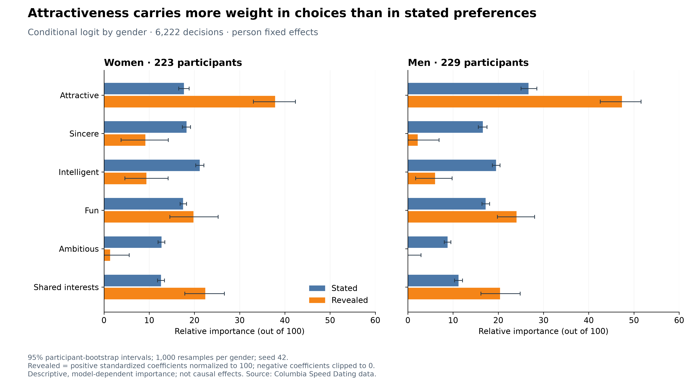
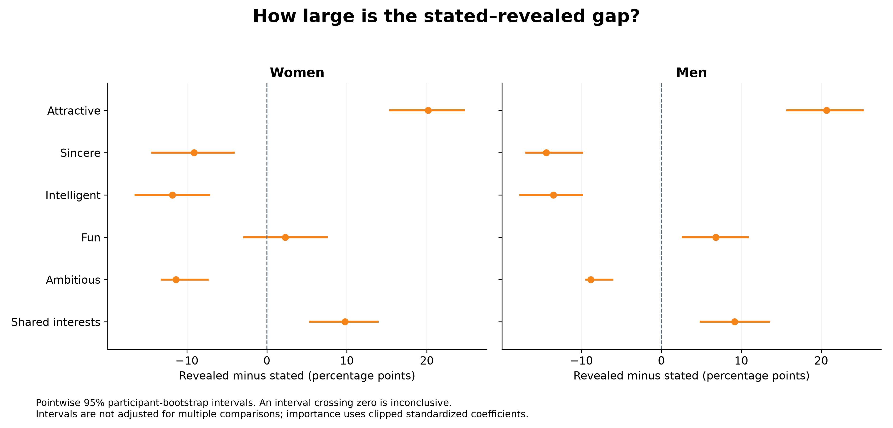

# Part 3: core-model results

Owner: Jiayi. Updated 2026-11-03. Implements the method in `PROJECT_CONTEXT.md`; supersedes the earlier standalone analysis with unscaled/signed coefficient shares.

## Headline

Attractiveness receives more relative importance in yes/no choices than in stated preferences: **17.7 versus 37.9 for women**, and **26.7 versus 47.4 for men**. The gaps are **+20.2 points (95% CI 15.3 to 24.8)** and **+20.7 points (15.6 to 25.3)** respectively.

## Results

| Gender | Attribute | Stated | Revealed | Gap (pp) | 95% gap interval |
|---|---|---:|---:|---:|---|
| Women | Attractive | 17.7 | 37.9 | +20.2 | [15.3, 24.8] |
| Women | Sincere | 18.3 | 9.2 | -9.1 | [-14.4, -4.0] |
| Women | Intelligent | 21.2 | 9.4 | -11.8 | [-16.5, -7.1] |
| Women | Fun | 17.5 | 19.8 | +2.3 | [-3.0, 7.6] |
| Women | Ambitious | 12.7 | 1.4 | -11.4 | [-13.3, -7.2] |
| Women | Shared interests | 12.6 | 22.4 | +9.8 | [5.3, 14.0] |
| Men | Attractive | 26.7 | 47.4 | +20.7 | [15.6, 25.3] |
| Men | Sincere | 16.6 | 2.2 | -14.4 | [-17.0, -9.8] |
| Men | Intelligent | 19.5 | 6.0 | -13.5 | [-17.8, -9.8] |
| Men | Fun | 17.2 | 24.0 | +6.8 | [2.6, 11.0] |
| Men | Ambitious | 8.8 | 0.0 | -8.8 | [-9.5, -6.0] |
| Men | Shared interests | 11.2 | 20.4 | +9.2 | [4.8, 13.6] |

Intervals are pointwise 95% participant-bootstrap percentile intervals. All gaps exclude zero except fun for women. These are exploratory comparisons across 12 gaps, not simultaneous/familywise significance tests. Use the gap interval to assess a difference; overlapping bar intervals are not the relevant test.

## Method

- **Data:** the canonical `data/processed/clean_unscaled.csv`, through `src.io.load_clean()`. No raw or cleaned data were altered. The input checksum is saved in the diagnostics JSON.
- **Outcome:** `dec`, the participant's own yes/no choice. Predictors are only `attr`, `sinc`, `intel`, `fun`, `amb`, `shar`. `match`, `dec_o`, `like`, and `prob` are excluded.
- **Model:** conditional fixed-effects binary logit grouped by `iid`, separately for gender 0 (women) and 1 (men). The likelihood conditions on each person's total yes count, so it permits multiple yes decisions and eliminates their stable selectivity intercept. It does not assume exactly one chosen date.
- **Standardization:** z-score each rating within each gender's retained model rows, using the population SD (`ddof=0`). Standardization is recomputed in every bootstrap draw. The full-sample means and SDs are in `core_model_scaling.csv`.
- **Stated share:** normalize each retained participant's six `*1_1` values to 100 and average once per person, avoiding overrepresentation of people with more dates. Use the same retained people for stated and revealed summaries.
- **Revealed importance:** `100 * max(beta_standardized, 0) / sum(max(beta_standardized, 0))`, as specified by the group. Negative coefficients are clipped only for this importance transformation. Signed standardized and original-scale coefficients, coefficient intervals, and per-SD odds ratios remain available in the results CSV.
- **Inference:** 1,000 whole-person bootstrap samples per gender, using shared seed 42. Each draw re-estimates scaling and coefficients, transforms importance, and recomputes the stated mean and gap from the same sampled people. Multiplicity-weighted likelihoods are equivalent to duplicating people with new stratum IDs. All 2,000 fits succeeded; no draws were discarded.

## Sample flow

| Stage | Women: decisions / people | Men: decisions / people |
|---|---:|---:|
| Original | 4,184 / 274 | 4,194 / 277 |
| Complete ratings and stated weights | 3,350 / 262 | 3,518 / 265 |
| Retained conditional-logit sample | 3,000 / 223 | 3,222 / 229 |

The main analysis therefore uses **6,222 decisions from 452 participants**. Complete-case filtering removes 1,510 rows. Of the remaining 527 people, 39 women and 36 men have no within-person outcome variation and are excluded, removing a further 646 rows. These counts replace the earlier preliminary counts in the project context. The canonical cleaning policy already treats invalid zero/out-of-range ratings as missing; this model adds no imputation.

## Validation

The notebook ran top to bottom from a fresh Python 3.11 kernel, starting in `notebooks/`, and saves executed tables and figures for GitHub viewing. Both fitted models agree with statsmodels to within 0.00021 in each standardized coefficient, and the exact log-likelihoods agree to numerical precision. Tests independently check the likelihood against subset enumeration, its analytic gradient against finite differences, bootstrap multiplicities against explicitly duplicated strata, and the zero-clipping rule. The environment versions, seed, input hash and convergence diagnostics are recorded in `outputs/tables/core_model_diagnostics.json`.

## Interpretation and limitations

The marketing takeaway is to validate survey preferences with observed choices. These results support comparing the two sources, not dismissing surveys or claiming respondents lied. Standardized/clipped importance and stated allocations are different constructs: the numerical gap is a model-dependent descriptive index, not a directly identified difference in true preferences.

Clipping creates a boundary at zero and can affect percentile-interval coverage. Men's ambition has zero reported importance because its estimated coefficient is negative, not because the model proves ambition never matters. Inspect the signed coefficient interval before interpreting the trait.

Post-date ratings can contain halo effects, measurement error and chemistry. The results are observational associations and this is conjoint-style choice analysis, not a randomized conjoint experiment. Person fixed effects remove stable participant differences, not date-level confounding. The participant bootstrap handles repeated decisions but not all dependence from shared partners or events; event-level/halo sensitivity checks belong with the robustness section. Survey formats also differ across waves.

Results apply to retained participants with varying choices; missingness and the graduate-student speed-dating sample limit generalization. A yes decision does not establish a mutual match or long-term compatibility. Separate models do not test whether gender differences are statistically significant.

## Files and rerunning

- `notebooks/02_core_model.ipynb`: executed analysis, ready to inspect on GitHub or rerun in VS Code.
- `src/core_model.py`: shared model and plotting implementation.
- `outputs/figures/core_model_stated_vs_revealed.png`: main slide chart (300 dpi; SVG also available).
- `outputs/figures/core_model_gap_intervals.png`: inference chart (300 dpi).
- `outputs/tables/core_model_results.csv`: estimates, importance/gaps and intervals.
- `outputs/tables/core_model_sample_flow.csv`: complete exclusion counts.
- `outputs/tables/core_model_scaling.csv`: means/SDs for downstream reproducibility.
- `outputs/tables/core_model_diagnostics.json`: numerical checks and provenance.
- `docs/core_model_presentation_notes.md`: speaking notes.

From the repo root, install `requirements.txt`, then run `python -m src.core_model` or Run All in the notebook. Tests: `python -m unittest discover -s tests -v`. The notebook also runs from its own `notebooks/` directory. Re-running replaces only these Part 3 output files.

## Sources and AI use

- [Project specification](../PROJECT_CONTEXT.md) and [cleaning audit](cleaning_audit_verdict.md).
- [Original data key](https://web.mit.edu/17.871/www/2009/speed_dating_codebook.pdf).
- [Statsmodels ConditionalLogit documentation](https://www.statsmodels.org/stable/generated/statsmodels.discrete.conditional_models.ConditionalLogit.html).
- Fisman, Iyengar, Kamenica & Simonson (2006), *Gender Differences in Mate Selection: Evidence From a Speed Dating Experiment*, QJE 121(2), 673–697.
- Codex assisted with implementation, execution, numerical checks, charts and explanatory drafts. See `AI_USAGE.md`. Team review is not claimed to have occurred.
