# Extended analyses: findings and how to use them

This report covers every extra analysis we tested, so you can choose what goes in the presentation. All of it is built, tested and reproducible. **Nothing here has to be used**, and none of the existing slides, notebooks or Part 3 and Part 4 results were changed.

Every number comes from `outputs/tables/ext_summary.csv` and the `ext_` tables. The full run used 1,000 bootstrap draws and seed 42.

## 1. The short version

**The story this supports:** people misreport what they want, better questions shrink that gap, and platforms should optimise for mutual matches rather than yeses.

| # | A marketer's question | Answer | Key number |
|---|---|---|---|
| A1 | Can I trust stated-importance surveys? | Not on their own. The gap is lasting, not noise | Attractiveness counts about 20 points more in choices; answers stay stable after 3-4 weeks (r=.75) |
| A2 | Can I write a better survey? | Yes. Ask what others want, and what drove past decisions | Looks gap falls from 17.4 to 6.9 (women) and 15.1 to 8.7 (men) |
| A3 | More survey data or more behaviour? | Behaviour | First 3 speed dates R² .29; full sign-up survey .01 to .10 |
| A4 | Do customers understand the market? | No | Guesses about a partner's yes score worse than predicting the average |
| A5 | Which metric should I optimise? | Mutual matches, not yeses | Revealed ranking: no clear match lift. Ranking for mutual interest: +2.5 to +7.1 pp |
| A6 | How much can personalisation do? | Less than people assume | 63-67% of a yes is unexplained, and pair facts add nothing |

**If time is tight, keep A2 and A3.** They speak most directly to the survey problem. Then add A5, because the existing slide 8 needs changing anyway.

**Recommended slide plan** (about six slides on top of the current Part 3 and 4 content):

| Slide | Content | Suggested owner |
|---|---|---|
| Survey trust | A1 plus the perceptual map (S1) | Person 3 |
| Better questions | A2 | Person 5 |
| Behaviour beats surveys | A3 and A6 | Person 4 |
| Customers misjudge the market | A4 | Person 2 |
| Rank for mutual interest | A5, with S3 as a supporting point | Person 6 |
| Robustness | R1 to R4, one chart | Person 5 |

## 2. What changed from our earlier conversations

The first versions were quick tests. Proper intervals changed several claims, so **use these numbers, not the earlier ones.**

| Earlier claim | Final result |
|---|---|
| Part 5 is empty | **Wrong now.** A teammate added `04_robustness_extensions updated.ipynb` on 7 November. See section 6 |
| Men weight attractiveness more than women | **Not clear.** Gap +0.30, 95% CI -0.09 to 0.68, p=.13. Sincerity is borderline (p=.05) |
| Revealed ranking gets more yeses | **Weaker.** Top 1: +2.2 pp, CI -1.5 to 6.4, not clear. Top 3: +2.3 pp, CI 0.6 to 4.1 |
| Mutual-interest ranking adds +5 to +7 pp | **Wider range.** +4.1 to +7.1 pp across five random splits. The +7.1 is the highest split. The stricter test gives +2.5 (top 3) and +5.1 (top 1) |
| The contrast effect might not survive correction | **It survives** the correction used here (adjusted p=.018) |
| Partner explains 15-17% of a yes | **14-16%** once the chooser is accounted for. Unexplained is 63-67% |
| People expect 3.03 matches and get 2.5 | **2.39** when compared on the same people |
| Any structured pairing beats random | **Only optimised, with one slot.** With two slots, all three beat random |
| Optimised match rate 24.3%, random 17.5% | **24.1% and 17.7%** |

## 3. Core findings

### A1. Can I trust stated-importance surveys?

- **Gap:** attractiveness gets 17.7 in surveys and 37.9 in choices for women (+20.2, CI 15.3 to 24.8). For men it's 26.7 and 47.4 (+20.7, CI 15.6 to 25.3).
- **Stable:** stated attractiveness correlates r=.75 with the same answer 3-4 weeks later (CI .67 to .83, 200 people). Asking again won't fix a bias that lasting.
- **Trade-offs:** one attractiveness point is worth 3.2 intelligence points for women (CI 2.0 to 7.0) and 6.3 for men (CI 3.5 to 23.8), and about 2 fun points for both. Men's figure is too wide to quote without its interval.
- **Marketing use:** treat self-explicated surveys as hypotheses and check them against real choices.
- **Caveat:** importance is a model-based index, not a literal percentage of what people want.
- **Files:** `ext_a1_retest.csv`, `ext_a1_tradeoffs.csv`, `ext_a1_gender_test.csv`.

### A2. Can I write a better survey?

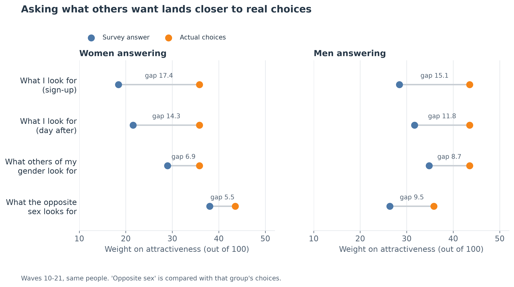

Compared on the same 268 people (waves 10-21):

| Question | Women's gap | Men's gap |
|---|---:|---:|
| What I look for (sign-up) | 17.4 | 15.1 |
| What I look for (day after) | 14.3 | 11.8 |
| What others of my gender look for | 6.9 | 8.7 |
| What the opposite sex looks for | 5.5 | 9.5 |

- **Across all six attributes**, the "others of my gender" question cuts average error by 3.6 points for women (CI 2.8 to 4.4) and 3.1 for men (CI 2.3 to 3.9). The "opposite sex" question only clearly helps for women.
- **Ask about past decisions (waves 15-21, same people):** "what drove my decisions" gives attractiveness 29.0 (women) and 36.3 (men), against 20.5 and 33.7 for "what I look for". The improvement is 8.5 points for women (CI 5.4 to 12.6) and 2.6 for men (CI 0.4 to 4.9).
- **The catch:** only the direct question says anything about the individual (t=3.6 vs t=0.2 on attractiveness). Ask both: others-focused for the market average, direct for differences between people.
- **Survey format matters:** with a 1-10 rating instead of 100 points, stated attractiveness drops 11.4 points for men and 3.4 for women. Waves weren't randomised, so treat this as suggestive.
- **Marketing use:** add indirect and past-behaviour questions. It's cheap, and it's the classic fix for social desirability bias (Fisher, 1993).
- **Files:** `ext_a2_wording.csv`, `ext_a2_ladder.csv`, `ext_a2_individual_signal.csv`, `ext_a2_survey_format.csv`.

### A3. Should I collect more survey data or more behaviour?

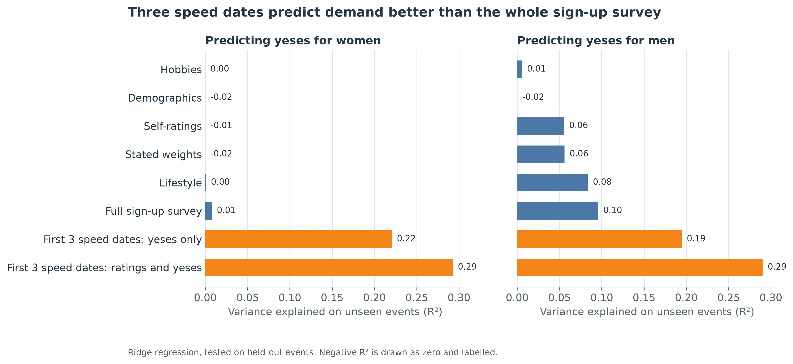

- **Result:** predicting how often a person gets a yes later in the evening, on unseen events, the first three speed dates reach R²=.29. The full sign-up survey reaches .01 for women and .10 for men. The advantage is .29 (CI .19 to .38) and .19 (CI .10 to .28).
- **Pair ranking:** using only pre-event facts, predicting which pairs match reaches AUC .58, with 21.5% matching in the top tenth against 16.5% overall (lift 1.31, CI 1.05 to 1.62).
- **Marketing use:** shorten onboarding and learn from early behaviour.
- **Caveat:** "first 3 dates" means the first three four-minute speed dates of an evening, not real dates. Ratings would need a product equivalent, such as early swipes.
- **Files:** `ext_a3_prediction.csv`, `ext_a3_r2_gap.csv`, `ext_a3_pre_event.csv`.

### A4. Do customers understand the market?

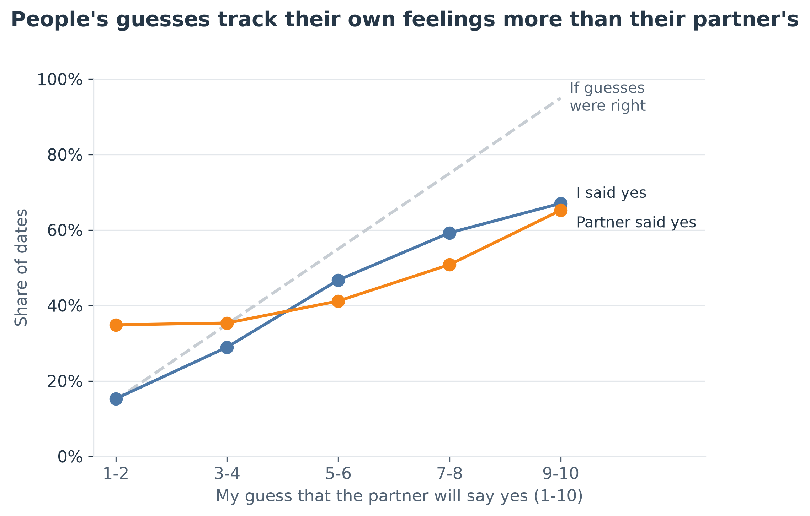

- **Reading interest:** people's guesses score worse than predicting the average for everyone (Brier .267 vs .245). They track the person's own decision better than the partner's (AUC .68 vs .58).
- **Overconfidence:** men overestimate acceptance by 15 pp (CI 12 to 18), women by 4 pp (CI 1 to 7).
- **What others want:** both genders underrate shared interests by 11.0 to 15.2 points, the biggest miss, and overrate ambition by 8.0 to 12.2 points.

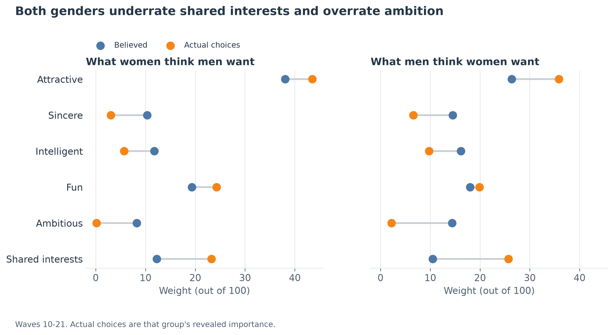

- **Self-image:** 68-76% believe others rate them above what they receive, and belief barely tracks reality (r=.04 to .28, waves 10-21). People expect 3.03 matches and get 2.39.
- **Belief changes expectations, not results:** each extra point of believed attractiveness adds 0.20 expected matches (p=.02), with no effect on actual match rate (p=.15).
- **Marketing use:** give users data-based guidance, such as leading with shared interests instead of career.
- **Caveats:** `prob` is only an outcome here; it must never predict `dec`. Don't claim that good readers get more matches, because people who expect a yes tend to say yes. Self-ratings and partner ratings may not use the scale the same way, so trust the correlations over the overrating share.
- **Files:** `ext_a4_calibration.csv`, `ext_a4_optimism.csv`, `ext_a4_beliefs.csv`, `ext_a4_self_image.csv`, `ext_a4_belief_effects.csv`.

### A5. Which metric should I optimise?

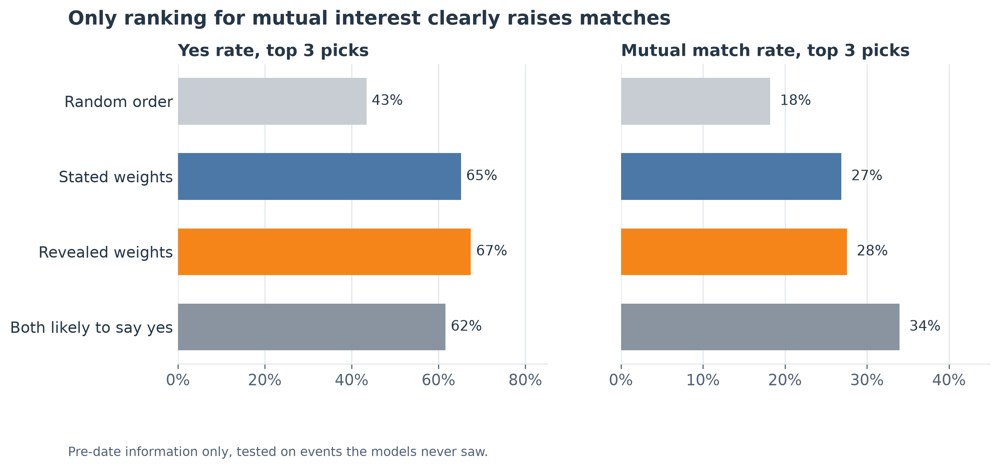

Using only information available before the date, on unseen events, for the top 3 picks:

| Ranking rule | Yes rate | Match rate | No match in top 3 |
|---|---:|---:|---:|
| Random order | 43% | 18% | 56% |
| Stated weights | 65% | 27% | 43% |
| Revealed weights | 67% | 28% | 43% |
| Both likely to say yes | 62% | 34% | 33% |

Random order is one random draw; each person's true average is 45% yes and 18% match.

- **Having a ranking matters more than which weights it uses.**
- **Revealed weights don't clearly raise matches:** +0.7 pp at top 3 (CI -1.0 to 2.3). The current slide 8 simulation shows the same: -1.1 pp (CI -2.7 to 0.4).
- **Ranking for mutual interest does:** +4.1 to +7.1 pp at top 3 across five splits, at a cost of 3.5 to 5.0 pp of yeses. The stricter test, which uses only early-evening history, gives +2.5 pp (CI 1.2 to 3.9) at top 3 and +5.1 pp (CI 1.6 to 8.3) at top 1. **Quote the range.**
- **Who benefits:** among the least-chosen third, people with no top-3 match fall from 73% to 57%.
- **Why it works:** all of the lift comes from favouring partners who say yes more often. Without that, it's -0.7 pp (CI -2.4 to 1.0). A real product would need a cap on mass-likers. Partners' stated preferences added nothing.

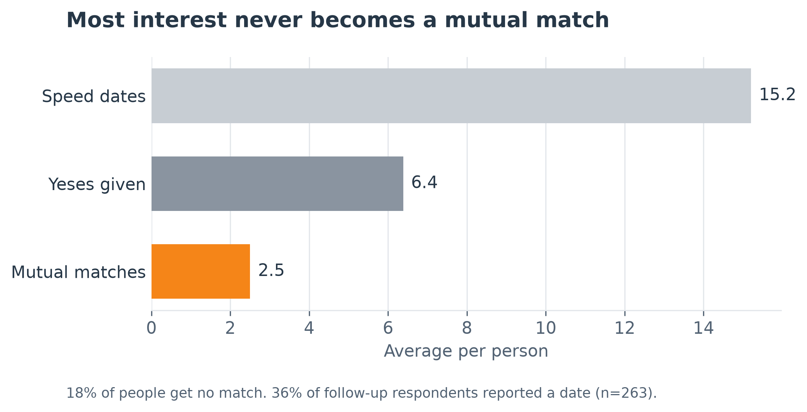

- **Funnel:** 15.2 speed dates lead to 6.4 yeses and 2.5 matches, and 18% of people get no match. Among people with at least one match, each extra match adds 6.2 pp to reporting a date (CI 3.5 to 8.9, n=226).
- **Weak retention signal:** people with no match answered the next-day survey less often (80% vs 90%).
- **Marketing use:** make mutual matches the target metric, especially for users at risk of getting none (see Pizzato et al., 2010, on reciprocal recommenders).
- **Caveats:** this is a replay of people already in the room, not a live test. Only 48% answered the follow-up, and dates can't be linked to a specific pair.
- **Files:** `ext_a5_ranking.csv`, `ext_a5_lifts.csv`, `ext_a5_seed_sensitivity.csv`, `ext_a5_history_design.csv`, `ext_a5_partner_model.csv`, `ext_a5_who_benefits.csv`, `ext_a5_exposure.csv`, `ext_a5_funnel.csv`.

### A6. How much can personalisation do?

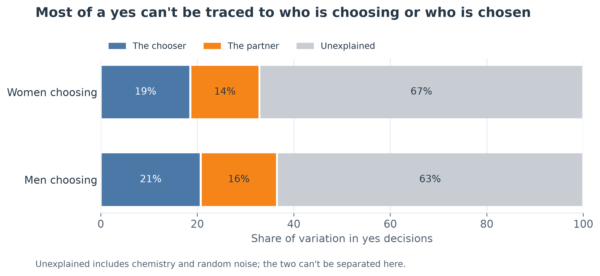

- **Result:** the chooser explains 19-21% of a yes, the partner 14-16%, and 63-67% is unexplained. Pair facts add nothing on unseen events (R²=-0.002).
- **It fits the literature:** Joel, Eastwick and Finkel (2017) also could not predict pair-specific desire from pre-meeting surveys.
- **Marketing use:** don't promise a perfect match. Invest in more good first interactions.
- **Caveat:** unexplained includes chemistry and random noise, and they can't be separated here. Each decision is observed once.
- **File:** `ext_a6_variance.csv`.

## 4. Supporting findings

### S1. Perceptual map

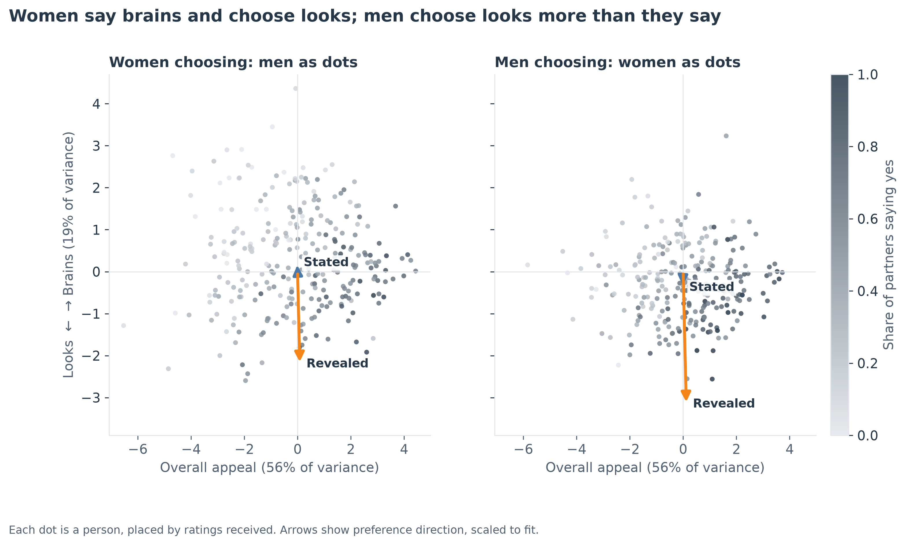

- **Result:** two axes emerge, overall appeal (56% of variance) and brains vs looks (19%). Women's stated arrow leans slightly towards brains and their revealed arrow firmly towards looks. Men lean towards looks in both, much more strongly in choices.
- **Use it as a picture, not as evidence.** Attractiveness alone explains 60-63% of yeses received, and all six traits only 65-66%.
- **Don't build a segment-level version:** segments explain under 1% of position on either axis.

### S2. Does the previous partner change the next decision?

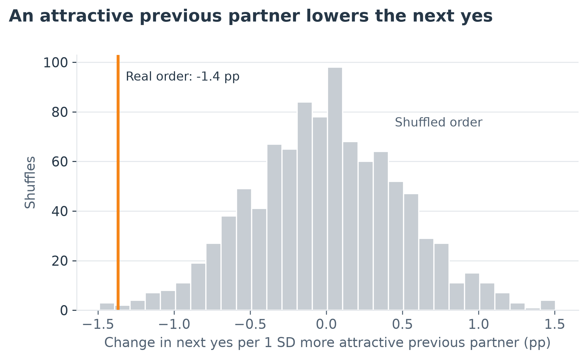

- **Result:** a 1 SD more attractive previous partner lowers the next yes by 1.4 pp (shuffled-order p=.008, adjusted .018). It's clear for men (-1.7 pp, p=.017) and not for women (-0.8 pp, p=.29). Ratings of the next partner don't change, only the decision.
- **This is a replication.** Bhargava and Fisman (2014) found this in the same dataset, also driven by men. Say so on the slide.
- **Marketing use:** what's shown just before an option can change how it's judged, so test feed order.
- **Why it's interesting:** it's the closest thing we have to a causal result, and it isn't a logistic importance model. Always show it with the placebo. It's small, and order wasn't randomised per person.

### S3. Market simulator

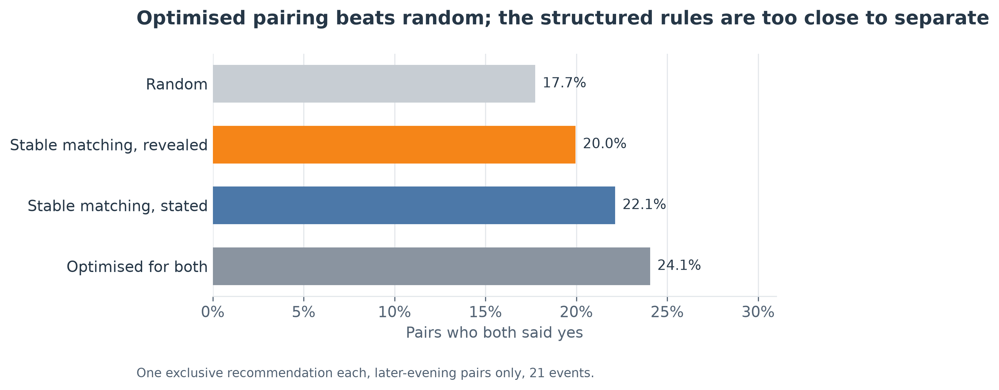

- **Result:** giving each person one exclusive recommendation produces matches for 17.7% (random), 20.0% (revealed stable matching), 22.1% (stated stable matching) and 24.1% (optimised for both).
- **What's clear:** optimised beats random by 6.3 pp (CI 2.5 to 10.3). With two slots, all three beat random by 4.4 to 5.0 pp.
- **What isn't:** optimised vs stated is +1.9 pp (CI -4.4 to 8.8), so don't claim one structured rule beats another.
- **Marketing use:** coordinating scarce recommendations helps (stable matching: Gale and Shapley, 1962). The weights matter less.

## 5. Robustness

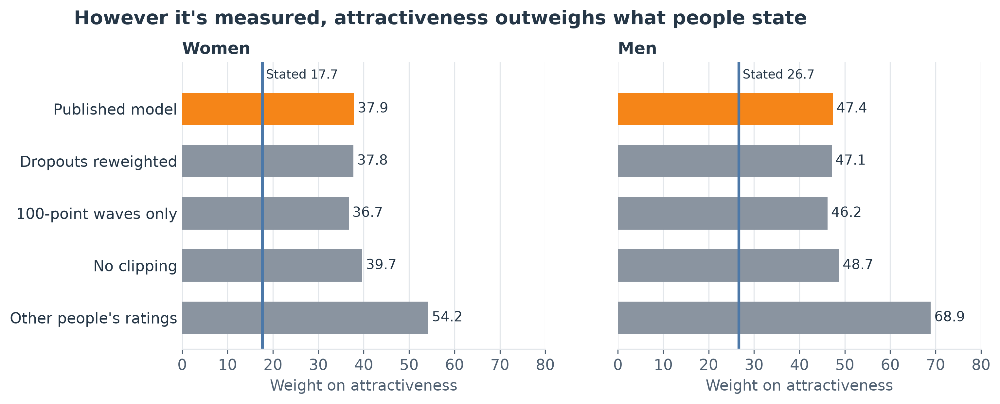

| Check | Result | Reading |
|---|---|---|
| R1 Other people's ratings instead of your own | 54.2 (women), 68.9 (men) | Not a halo effect. Attractiveness is also rated most consistently (r about .5 vs .2-.4), which favours it, and shared interests fall for men because they're pair-specific |
| R2 No clipping (relative weights) | 39.7, 48.7 | Close to the published 37.9 and 47.4. The method has critics (Thomas et al., 2014), so use it as a check only |
| R3 Reweighting for dropouts | No importance moves more than 0.3 | Dropouts don't change the answer |
| R4 100-point waves only | Gaps 18.4 and 17.3 vs 20.2 and 20.7 | Still large, but **disclose it**. Pooling formats adds about 9% to the women's gap and 16% to the men's |
| R5 Behavioural segments | Held-out fit gets worse by 8.5 to 30.2 log-likelihood points | No reliable behavioural segments |
| R6 Survey segments | Silhouette .20; choices don't differ (p=.46, p=.14) | Survey segments don't predict behaviour. They add 1.4% to match rate explained |

The last two answer the original segmentation idea: keep it as one line, "survey segments don't predict behaviour".

**Not recommended, kept for the record:**

| Test | Result | Why not |
|---|---|---|
| N1 Event goals | Women p=.23; men p=.02 | Only 18 women and 32 men in the serious group. Men's result comes from small groups |
| N2 Similarity matters more to those who say so | +0.4 pp interaction, p=.54 | No effect. Hobby similarity adds +1.9 pp per SD, and +0.4 once ratings are included |
| N3 Event size | p=.26 | No shift, and only 21 events |
| N4 Polarising looks | -0.023 and +0.017 | Opposite signs by gender. No general rule |
| N5 Instrumental variables | Attractiveness interval 9 to 54 | Far too noisy |
| N6 Learning from first choices | -0.1 pp over population weights | No gain (CI -1.0 to 0.7) |
| N7 "After a yes, the next yes drops" | -5.8 pp vs -6.9 pp when shuffled | A mechanical artifact |
| N8 Who the survey works for | Beats population weights for 20%, ties for 32% | Nothing observable identifies them (R²=.02). Works as a one-liner |
| N9 Stated race importance | +1.1 pp (women) and +1.0 pp (men) per point | Surveys can work on concrete items, but it's sensitive, and men's result (adjusted p=.056) doesn't clear .05 |

## 6. How this fits with the other work

**Part 5** (`notebooks/04_robustness_extensions updated.ipynb`) covers different ground, and the results agree:

- **Sign-up vs recalled weights:** attractiveness rises 8.3 points (123 people), consistent with A2.
- **Order:** no effect on yes rate (p=.78, p=.86). That doesn't conflict with S2, which is about who came just before, not position in the evening.
- **Event condition:** a small association (p=.05), confounded with event.
- **Stated weights in prediction:** no improvement, consistent with A3 and N8.

**Recent edits to the Person 6 docs and `05_customer_value.ipynb`** are uncommitted at the time of writing. They already separate feed ranking from scarce recommendations, which fits this report. The fixes below reflect their current state.

## 7. Fixes to the existing deck, if you use this

| Where | Problem | Fix |
|---|---|---|
| Slide 8 and `05_customer_value` | Ranks on ratings made after the date, which an app wouldn't have | Show pre-date figures from A5: top-1 yes about 72-74%, against 45% on average |
| [Script line 31](person6_presentation_script.md) and the backup table in [`person6_slides_8_10.md`](person6_slides_8_10.md) | Say mutual match would show more headroom. It shows none for revealed ranking | Remove the claim |
| Script and slide notes: "favour revealed weights for first-slot engagement" | Rests on post-date ratings. Pre-date, top 1 isn't clear | Say a small yes lift at top 3 (+2.3 pp) |
| Slide 10 limitations | Survey format is described as a small inconsistency | Disclose R4 |
| `outputs/tables/customer_value_lift.csv` | Men and women rows repeat the pooled CI, from the loop in `src/customer_value.py` | Don't quote gender CIs from it until fixed |
| `add_match_scores` in `src/customer_value.py` | Applies standardised weights to raw ratings | Small effect: the correct scale gives +2.7 pp at top 1 vs the published +3.1 (+2.4 pp on unseen events) |
| `README.md` | Linked to a missing file, `docs/core_model_presentation_notes.md` | Add the file or remove the link |

## 8. How to use the code

### Run it

From the repo root:

```bash
source .venv/bin/activate      # Windows: .venv\Scripts\activate
python -m unittest discover -s tests -v
python -m src.extended_analysis
```

- **Runtime:** under 4 minutes on the machine used here.
- **Order:** Part 3 outputs must exist first, because the code checks its sample against them (6,222 decisions, 452 people).
- **Reproducible:** two full runs gave byte-identical tables. Change the data or Part 3 and you need to rerun this.
- **Quick test:** `python -m src.extended_analysis --n-boot 100` is faster, with rougher intervals. Don't quote those numbers, and rerun at the full setting afterwards.

### Open the notebook

`notebooks/06_extended_analysis.ipynb` shows every table and chart, and opens instantly because it reads saved results. Set `REBUILD = True` in the first code cell to recompute.

**Activate `.venv` before starting Jupyter.** Otherwise the kernel can pick up a global Python and stop with an `ImportError` about `scipy`.

### Find what you need

| You want | Look at |
|---|---|
| Everything on one page | `outputs/tables/ext_summary.csv`, with one row per finding, its interval, p-values and tier |
| A number for a slide | The table named in that row of the summary, in `outputs/tables/` |
| A chart | `outputs/figures/ext_*.png`, 300 dpi |
| The method | The function with that ID in the code, such as `a2_better_survey` |

Reading the summary: `A` is core, `S` supporting, `R` robustness, `N` not recommended. `p_adjusted` corrects for testing many things at once and only covers primary tests, so prefer it to `p`.

### Code map

| File | Contains |
|---|---|
| `src/ext_features.py` | Shared sample, features, model fitting and statistics. **Read its opening note before changing a ranking feature** |
| `src/ext_survey.py` | A1, A2, A4, S1, R1 to R6, N1 to N5, N8, N9 |
| `src/ext_market.py` | A3, A5, A6, S2, S3, N6, N7 |
| `src/ext_figures.py` | All charts |
| `src/extended_analysis.py` | Runner, summary table, tiers and question wording |
| `tests/test_extended.py` | 18 checks on the sample, leakage, placebo and matching |

### Change something

| To change | Edit |
|---|---|
| Bootstrap draws | `--n-boot`, or `N_BOOT` in `src/ext_features.py` |
| Shuffles or random splits | `N_PERMUTATIONS` or `SEEDS` in `src/ext_market.py` |
| Chart wording | The matching function in `src/ext_figures.py` |
| Skip an analysis | Remove it from `ANALYSES` in `src/ext_survey.py` or `src/ext_market.py`, and check its chart isn't still needed |

Two rules keep the results valid. Never rank on a leave-one-out feature, because it secretly contains the outcome: that bug twice produced false results during development. And never use `match`, `dec_o`, `like` or `prob` to predict `dec`.

`requirements.txt` says `pandas>=2.0`, but this code needs 2.2 or later.

## 9. Limits to state

- **Sample:** Columbia graduate students, 2002-2004, heterosexual speed dating, about 15 meetings each.
- **No revenue data:** matches, reported dates and survey response are stand-ins. Describe these as likely revenue drivers, not measured gains.
- **"Yes" means wanting to meet again**, after four minutes. There's no pair-level second-date data.
- **Replays, not experiments:** the ranking and market results only reorder people who met. Recommend A/B tests.
- **Mostly observational:** S2 is the only near-causal result. A2's format comparison isn't randomised.
- **Many tests:** 33 primary tests were corrected for together, but the other figures weren't. Small effects should be presented cautiously.
- **Interval types:** most resample people, S3 resamples the 21 events, and S2 uses shuffled order. A few regression p-values use clustered standard errors.

## 10. Sources

- Bhargava, S., & Fisman, R. (2014). Contrast effects in sequential decisions: Evidence from speed dating. *Review of Economics and Statistics*, 96(3), 444-457. https://doi.org/10.1162/REST_a_00416
- Fisher, R. J. (1993). Social desirability bias and the validity of indirect questioning. *Journal of Consumer Research*, 20(2), 303-315. https://doi.org/10.1086/209351
- Fisman, R., Iyengar, S. S., Kamenica, E., & Simonson, I. (2006). Gender differences in mate selection: Evidence from a speed dating experiment. *Quarterly Journal of Economics*, 121(2), 673-697. https://doi.org/10.1162/qjec.2006.121.2.673
- Gale, D., & Shapley, L. S. (1962). College admissions and the stability of marriage. *American Mathematical Monthly*, 69(1), 9-15.
- Joel, S., Eastwick, P. W., & Finkel, E. J. (2017). Is romantic desire predictable? Machine learning applied to initial romantic attraction. *Psychological Science*. https://doi.org/10.1177/0956797617714580
- Johnson, J. W. (2000). A heuristic method for estimating the relative weight of predictor variables in multiple regression. *Multivariate Behavioral Research*, 35, 1-19.
- Pizzato, L., Rej, T., Chung, T., Koprinska, I., & Kay, J. (2010). RECON: A reciprocal recommender for online dating. *Proceedings of the Fourth ACM Conference on Recommender Systems*, 207-214. https://doi.org/10.1145/1864708.1864747
- Thomas, D. R., Zumbo, B. D., Kwan, E., & Schweitzer, L. (2014). On Johnson's (2000) relative weights method for assessing variable importance: A reanalysis. *Multivariate Behavioral Research*, 49, 329-338.
